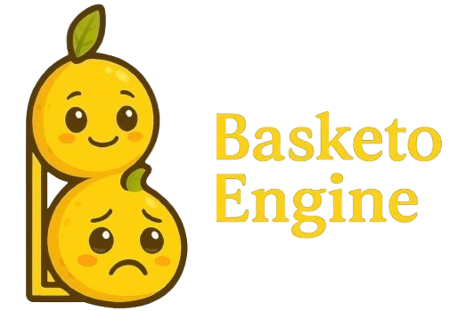
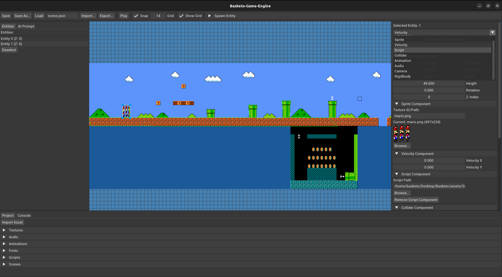

    

<h2 align="center">Create, Play, Inspire. Games Brought to Life. ✨</h2>

 <!-- Replace your_discord_server_id with your actual server ID -->

Welcome to the Basketo Engine - a passion project where I’m putting my best shot into creating something awesome and performant engine, with the exciting plan of making it an AI-Native game engine. Whether you’re here to contribute, suggest ideas, or just watch it grow, you’re part of the journey!

## 🚀 Current State of the Engine

  

